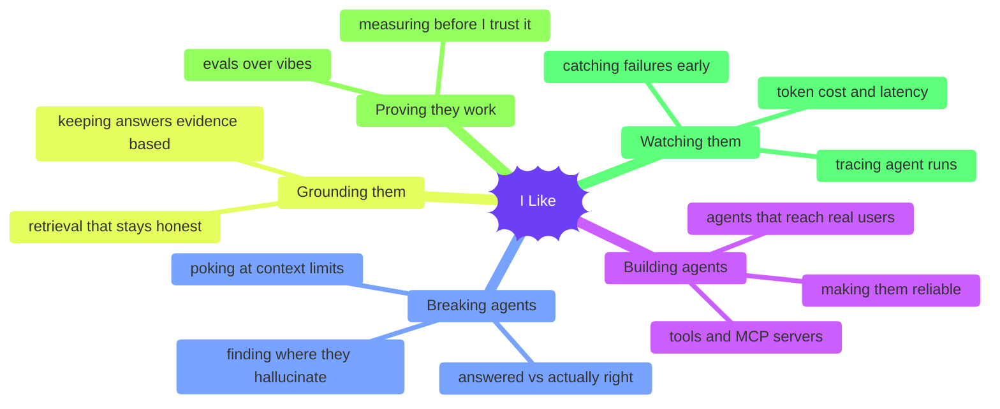

# Hey, I'm Ramya 👋

### AI Software Engineer | Building Production AI Agents, Full-Stack Applications & ML Systems.

I see a problem that bothers me, I pick up my laptop, and I build something to fix it. I've always been the curious kid who couldn't stop asking "but why?" and I never really grew out of it. That's probably why I fell in love with software engineering: I don't have to wonder for months whether an idea will work. I can build it, test it, watch it fail, change a few things, and suddenly it works. That little dopamine hit keeps me coming back to build more.

Today I build intelligent systems using AI. What excites me most is teaching software to do more than answer questions. What if it could understand what you need, figure out the next steps, use tools, and actually get things done for you? That's the world of AI agents I love exploring. Making something work once is easy. Making it work reliably for real people is the challenge I enjoy.

I also tend to ask "why are we building this?" before "how do we build it?" A clever solution means very little if it doesn't solve a problem someone actually has, and sometimes the smartest thing to build is far simpler than you first imagined. I like to move fast, so AI coding tools are part of how I work, but I still believe good engineering comes down to knowing what to build, making thoughtful decisions, and owning what you ship.

If you've got a problem that needed fixing yesterday, ping me.

---

## 🧪 Currently...

I basically like the whole loop of building Intelligent systems and test the limitations of AI.

---

## ✍️ I write sometimes...

[**→ Read on Substack**](https://substack.com/@ramyalakshmiiks)

---

💬 Always up for a conversation!  
Find me on [LinkedIn](https://www.linkedin.com/in/ramyalakshmiks).
